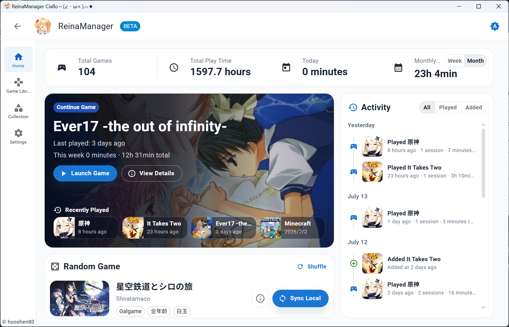
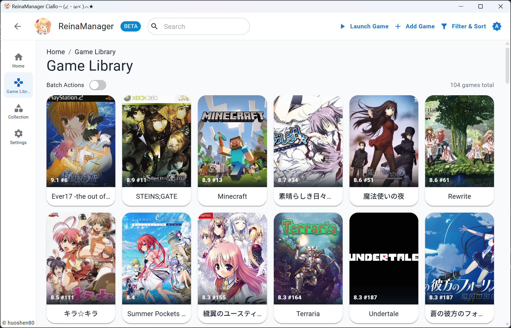
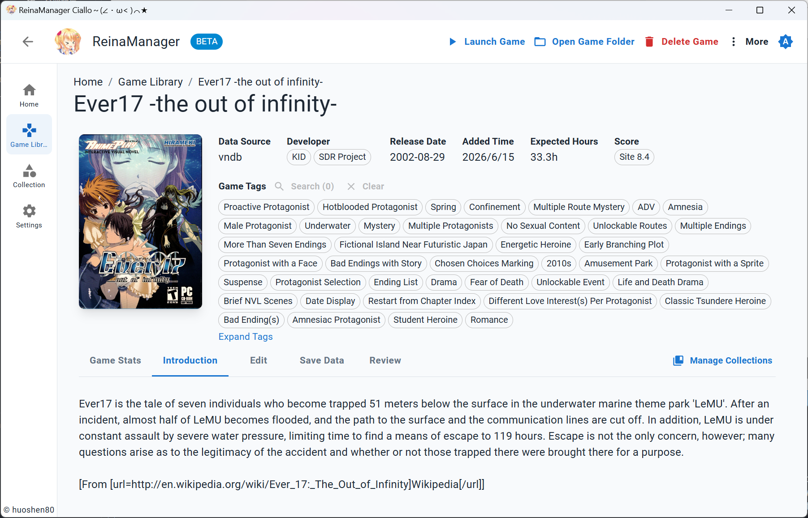
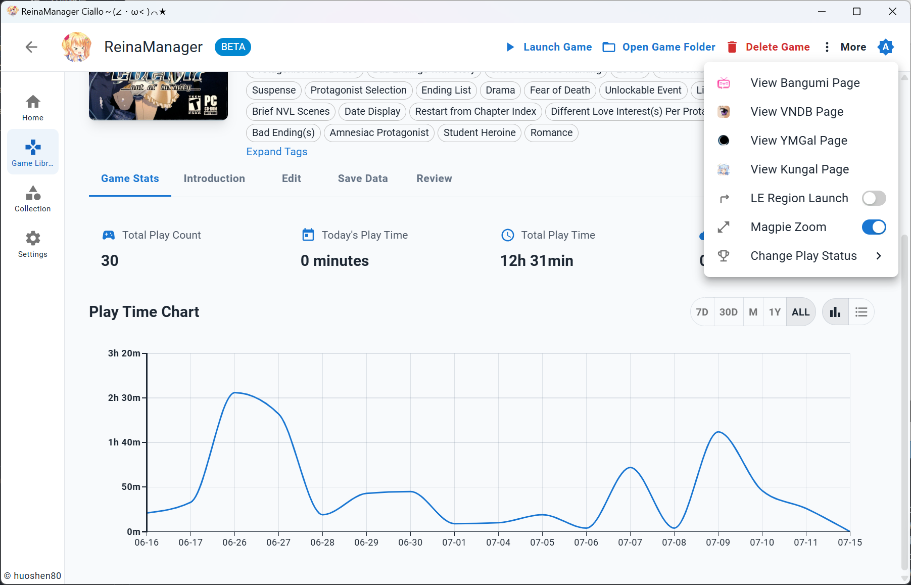
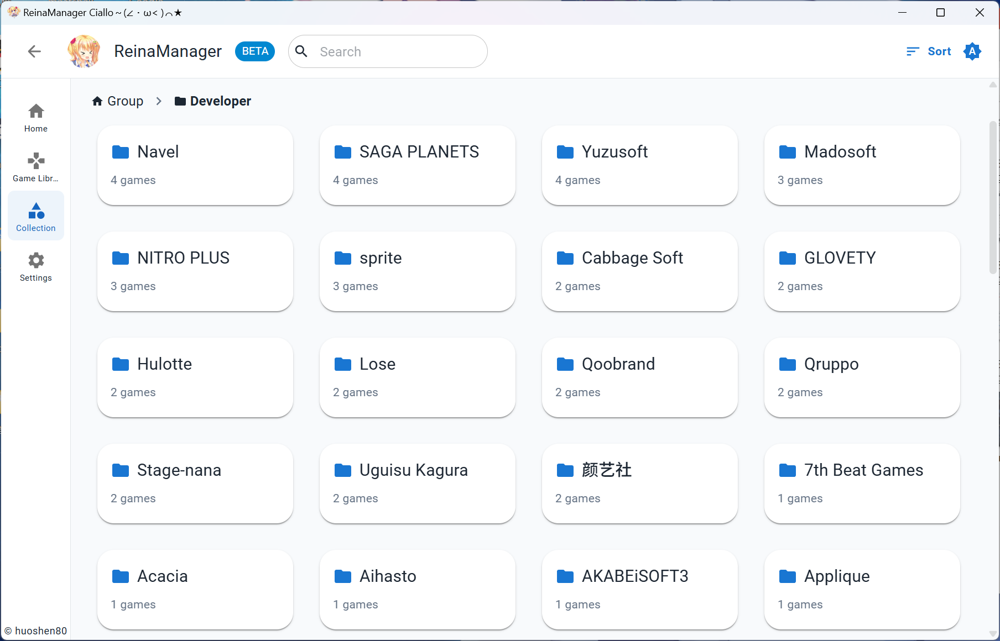

<div align="center">
  <div style="width:200px">
    <a href="https://vndb.org/c64303">
      
    </a>
  </div>

<h1>ReinaManager</h1>

    

[](https://qm.qq.com/q/lnCUkVjTpu) [](https://wakatime.com/badge/user/36a51c62-bf3b-4b81-9993-0e5b0e7ed309/project/efb3bd00-20c2-40de-98b6-e2f4a24bc120)

開発時間の記録は v0.9.0 から開始

<p align="center"><a href="./README.md">English</a>|<a href="./README.zh_CN.md">中文</a>|<a href="./README.zh_TW.md">繁體中文</a>|日本語</p>

<h5>軽量なギャルゲー・ビジュアルノベル管理ツール、開発中...</h5>

名前の `Reina` は、ゲーム <a href="https://vndb.org/v21852"><b>金色ラブリッチェ(Kin'iro Loveriche)</b></a> のキャラクター <a href="https://vndb.org/c64303"><b>妃 玲奈(Kisaki Reina)</b></a> に由来しています

</div>

## Stacks

- Tauri 2

- React

- Material UI

- UnoCSS

- Zustand

- TanStack Query

- Sqlite

- Rust

- SeaORM

## 機能

- 🌐 **マルチソースデータ統合** - 複数のソース API からゲームメタデータをシームレスに取得・統合・表示
- 🔍 **強力な検索** - ゲームタイトル、別名、カスタム名、その他の情報からゲームを素早く検索
- 🗂️ **フィルターと並び替え** - ソース、ステータス、タグなど、複数の条件でゲームをフィルター・並び替え
- 📚 **コレクション管理** - グループとカテゴリでゲームライブラリを整理し、ドラッグ＆ドロップによる並び替えをサポート
- 🎮 **プレイ時間追跡** - ゲームセッションを自動記録し、詳細なプレイ時間統計と履歴を提供
- 🎨 **パーソナライズ** - ゲームカバー、名前、概要、タグなどの情報をカスタマイズし、自分だけのゲームライブラリを構築
- 🔄 **バッチ操作** - API からゲームメタデータを一括でインポート・追加・更新可能
- 🌍 **多言語サポート** - 簡体字中国語、繁体字中国語、英語、日本語などに対応した完全な国際化サポートを提供
- 🔒 **NSFW フィルター** - 簡単なスイッチでNSFWコンテンツを非表示またはカバー
- 💾 **セーブデータバックアップ** - ゲームセーブデータの手動・自動バックアップに対応
- 🛠️ **ツール統合** - ゲーム起動時に Locale Emulator のロケール切り替えと Magpie 拡大を連動
- 🔄 **クラウドコレクション同期** - クラウドサービスからコレクションをインポートし、ゲームのステータス、評価点、レビューを同期

## スクリーンショット








詳細については、最新のリリース版をダウンロードしてください：[ダウンロード](https://github.com/huoshen80/ReinaManager/releases)

## 他の管理ツールからの移行

[reina_migrator](https://github.com/huoshen80/reina_migrator) を使うと、他の管理ツールのゲームライブラリやプレイ記録などを ReinaManager に移行できます。現在、以下に対応しています：

- **WhiteCloud v0.4.0**
- **Playnite 10**（[Reina Exporter](https://github.com/huoshen80/Reina-Playnite-Exporter) プラグインが必要）

## 開発とコントリビュート

Issue、提案、プルリクエストを歓迎します。開発前に[プロジェクトドキュメント](docs/README.md)を読み、モジュールの責務と開発規約を確認してください。

### ローカルでの実行

[Node.js](https://nodejs.org/)、[pnpm](https://pnpm.io/)、[Rust](https://www.rust-lang.org/)、および各プラットフォームの Tauri ビルド依存関係を準備してください。pnpm は `package.json` の `packageManager` に指定されたバージョンを使用してください。

1. リポジトリをクローン：
   ```bash
   git clone https://github.com/huoshen80/ReinaManager.git
   cd ReinaManager
   ```
2. 依存関係をインストール：
   ```bash
   pnpm install
   ```
3. 開発モードを起動：
   ```bash
   pnpm tauri dev
   ```
4. アプリをビルド：
   ```bash
   pnpm tauri build
   ```

## 支援する
もしこのプロジェクトが役立つと感じ、継続的な開発を支援したい場合は、ご支援を検討いただければ幸いです。皆様の応援が大きな励みになります！
- [Sponsor link](https://huoshen80.top/233.html)

## 謝辞

- **[Bangumi](https://bangumi.tv/)** - Bangumi 番組計画

- **[VNDB](https://vndb.org/)** - the visual novel database

- **[Ymgal](https://www.ymgal.games/)** - 月幕Galgame

- **[Kungal](https://www.kungal.com/)** - 鲲 Galgame

- **[Hikarinagi](https://www.hikarinagi.org/)** - 你和同好的ACGN社区

- **[Shionlib](https://shionlib.com/)** - ギャルゲー,リソースサイト,無料,オープンソース,気軽

これらのプラットフォームが提供する公開 API、データ、リソースに心より感謝します！

- **[7-Zip](https://www.7-zip.org/)** - Windows 版に公式コマンドラインツールを同梱し、ダウンロードしたゲームのアーカイブ展開に使用しています。

- **[7-Zip ZS (7-Zip-zstd)](https://github.com/mcmilk/7-Zip-zstd)** - Windows 版で 7-Zip と組み合わせて使用する Zstd プラグインと、Linux x64/arm64 版で使用するコマンドラインツールを提供しています。

## ライセンス

本プロジェクトは [AGPL-3.0 ライセンス](https://github.com/huoshen80/ReinaManager#AGPL-3.0-1-ov-file) の下で公開されています。

## Star履歴

<a href="https://www.star-history.com/?repos=huoshen80%2FReinaManager&type=date&legend=top-left">
 <picture>
   <source media="(prefers-color-scheme: dark)" srcset="https://api.star-history.com/chart?repos=huoshen80/ReinaManager&type=date&theme=dark&legend=top-left&sealed_token=8hJwvRzfF7BXsrTDsmX91vlKMmh-OU782v2ckuiCUm8XJc8v4vPWELSEqWkvVUZQhWnPygevDuNNJesLHwTVfm61OTlK0coF2jHWtmBIpC6kFrYHIVv6G5bHXVR0PkVEMtWasv4ybAZvIPPkGeSRZsopqmZoDStENlqvrCZxvxa4p3mkV99cA1ndh02b" />
   <source media="(prefers-color-scheme: light)" srcset="https://api.star-history.com/chart?repos=huoshen80/ReinaManager&type=date&legend=top-left&sealed_token=8hJwvRzfF7BXsrTDsmX91vlKMmh-OU782v2ckuiCUm8XJc8v4vPWELSEqWkvVUZQhWnPygevDuNNJesLHwTVfm61OTlK0coF2jHWtmBIpC6kFrYHIVv6G5bHXVR0PkVEMtWasv4ybAZvIPPkGeSRZsopqmZoDStENlqvrCZxvxa4p3mkV99cA1ndh02b" />
   
 </picture>
</a>
