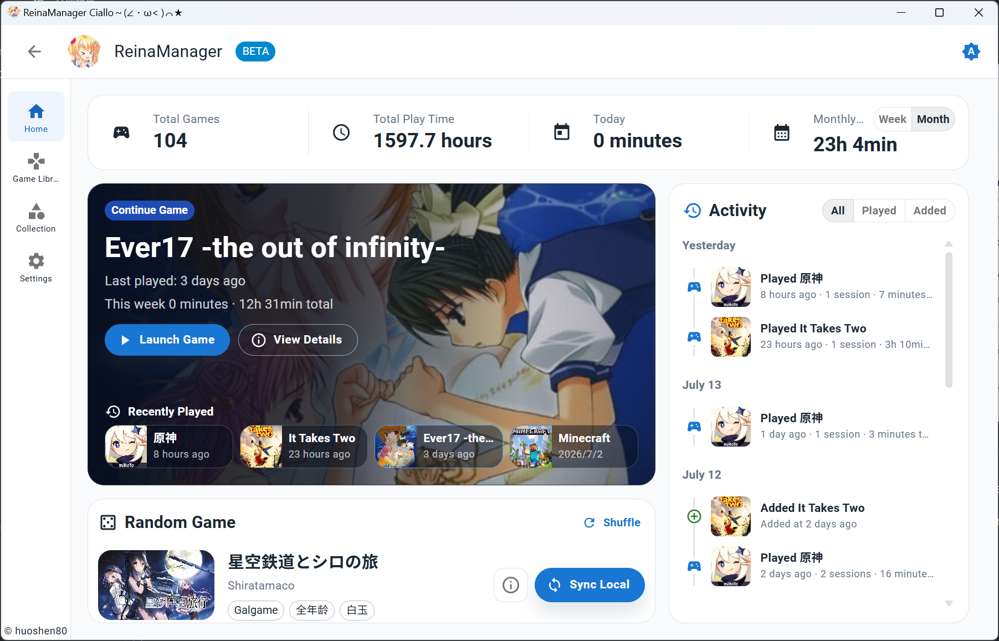
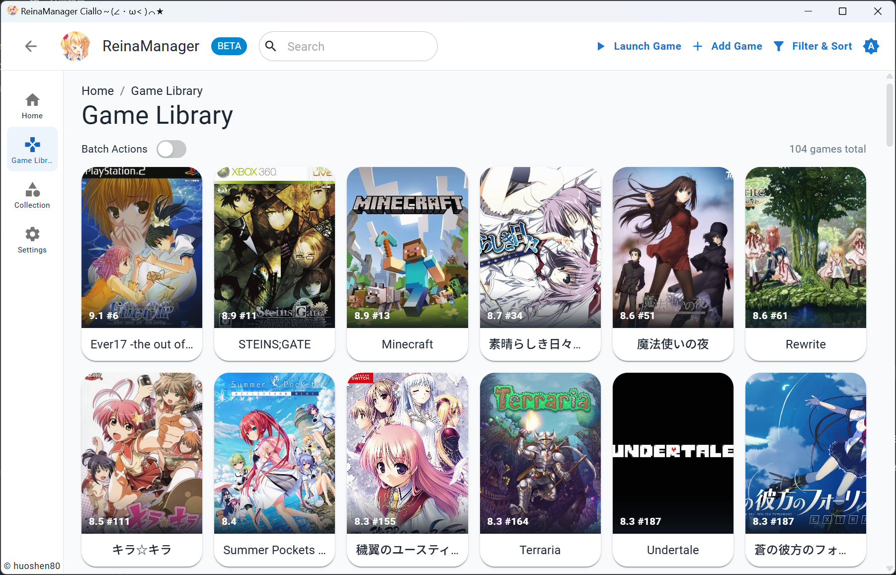
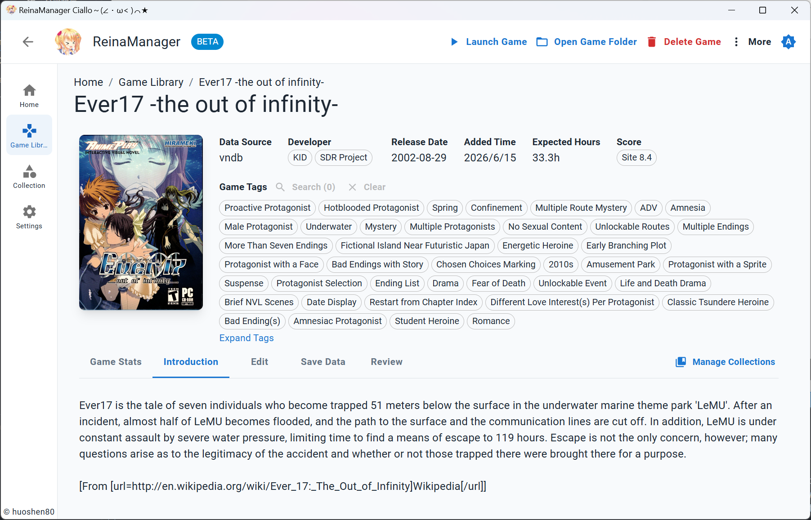
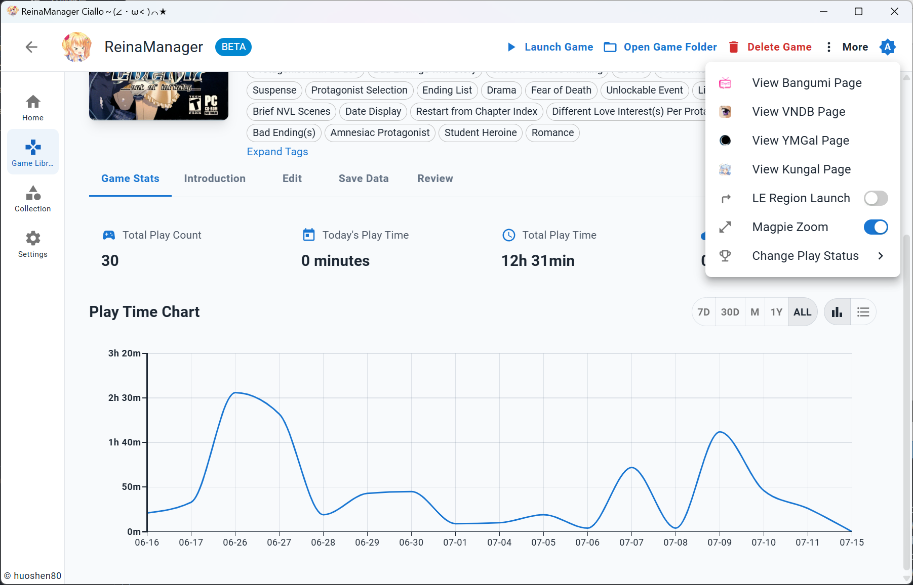
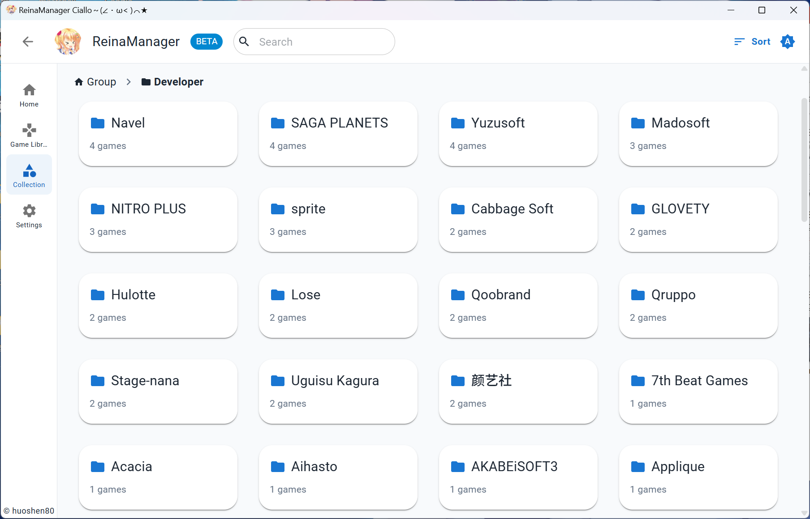

<div align="center">
  <div style="width:200px">
    <a href="https://vndb.org/c64303">
      
    </a>
  </div>

<h1>ReinaManager</h1>

    

[](https://qm.qq.com/q/lnCUkVjTpu) [](https://wakatime.com/badge/user/36a51c62-bf3b-4b81-9993-0e5b0e7ed309/project/efb3bd00-20c2-40de-98b6-e2f4a24bc120)

Development time tracked since v0.9.0

<p align="center">English|<a href="./README.zh_CN.md">中文</a>|<a href="./README.zh_TW.md">繁體中文</a>|<a href="./README.ja_JP.md">日本語</a></p>

<h5>A lightweight Galgame / Visual Novel manager, under development...</h5>

The `Reina` in the name is the character <a href="https://vndb.org/c64303"><b>妃 玲奈(Kisaki Reina)</b></a> from game <a href="https://vndb.org/v21852"><b>金色ラブリッチェ(Kin'iro Loveriche)</b></a>

</div>

## Stacks

- Tauri 2

- React

- Material UI

- UnoCSS

- Zustand

- TanStack Query

- Sqlite

- Rust

- SeaORM

## Features

- 🌐 **Multi-source Data Integration** - Seamlessly fetch, merge and display game metadata from multiple source APIs
- 🔍 **Powerful Search** - Quickly search games by titles, aliases, custom names, and other information
- 🗂️ **Filter and Sort** - Filter and sort games across multiple dimensions, such as source, status, tags, and more
- 📚 **Collection Management** - Organize your game library with groups and categories, with support for drag and drop sorting
- 🎮 **Play Time Tracking** - Automatic gameplay session recording with detailed play time statistics and history
- 🎨 **Customization** - Customize game covers, names, descriptions, tags, and other information to build your own game library
- 🔄 **Batch Operations** - Support bulk import, add and update game metadata from APIs
- 🌍 **Multi-language Support** - Complete i18n support, including Simplified Chinese, Traditional Chinese, English, Japanese, and more
- 🔒 **NSFW Filter** - Hide or cover NSFW content with a simple toggle
- 💾 **Savedata Backup** - Support manual and automatic backup of game savedata
- 🛠️ **Tool Integration** - Launch games with Locale Emulator locale switching and Magpie upscaling integration
- 🔄 **Cloud Collection Sync** - Import collections from cloud platforms and sync game status, ratings, and reviews

## Screenshots








For more, you can download the latest Release Version: [Download](https://github.com/huoshen80/ReinaManager/releases)

## Migrate from Other Managers

[reina_migrator](https://github.com/huoshen80/reina_migrator) can migrate game libraries, play records, and other data from other managers to ReinaManager. Currently supported:

- **WhiteCloud v0.4.0**
- **Playnite 10** (requires the [Reina Exporter](https://github.com/huoshen80/Reina-Playnite-Exporter) plugin)

## Development and Contributions

Issues, suggestions, and pull requests are welcome. Before development, read the [project documentation](docs/README.md) for module boundaries and development conventions.

### Run Locally

Install [Node.js](https://nodejs.org/), [pnpm](https://pnpm.io/), [Rust](https://www.rust-lang.org/), and the Tauri build dependencies for your platform. Use the pnpm version specified by `packageManager` in `package.json`.

1. Clone the repository:
   ```bash
   git clone https://github.com/huoshen80/ReinaManager.git
   cd ReinaManager
   ```
2. Install dependencies:
   ```bash
   pnpm install
   ```
3. Start development mode:
   ```bash
   pnpm tauri dev
   ```
4. Build the application:
   ```bash
   pnpm tauri build
   ```

## Sponsor
If you find this project helpful and would like to support its development, you can consider sponsoring. Your support is greatly appreciated!
- [Sponsor link](https://huoshen80.top/233.html)

## Acknowledgements

- **[Bangumi](https://bangumi.tv/)** - Bangumi 番组计划

- **[VNDB](https://vndb.org/)** - the visual novel database

- **[Ymgal](https://www.ymgal.games/)** - 月幕Galgame

- **[Kungal](https://www.kungal.com/)** - 鲲 Galgame

- **[Hikarinagi](https://www.hikarinagi.org/)** - 你和同好的ACGN社区

- **[Shionlib](https://shionlib.com/)** - A Visual Novel/Galgame Archive

Special thanks to these platforms for providing public APIs, data, and resources!

- **[7-Zip](https://www.7-zip.org/)** - provides the official command-line tool bundled on Windows to extract downloaded game archives.

- **[7-Zip ZS (7-Zip-zstd)](https://github.com/mcmilk/7-Zip-zstd)** - provides the Zstd codec plugin bundled with 7-Zip on Windows and the command-line tool used on Linux x64/arm64.

## License

This project is licensed under the [AGPL-3.0 license](https://github.com/huoshen80/ReinaManager#AGPL-3.0-1-ov-file)

## Star History

<a href="https://www.star-history.com/?repos=huoshen80%2FReinaManager&type=date&legend=top-left">
 <picture>
   <source media="(prefers-color-scheme: dark)" srcset="https://api.star-history.com/chart?repos=huoshen80/ReinaManager&type=date&theme=dark&legend=top-left&sealed_token=8hJwvRzfF7BXsrTDsmX91vlKMmh-OU782v2ckuiCUm8XJc8v4vPWELSEqWkvVUZQhWnPygevDuNNJesLHwTVfm61OTlK0coF2jHWtmBIpC6kFrYHIVv6G5bHXVR0PkVEMtWasv4ybAZvIPPkGeSRZsopqmZoDStENlqvrCZxvxa4p3mkV99cA1ndh02b" />
   <source media="(prefers-color-scheme: light)" srcset="https://api.star-history.com/chart?repos=huoshen80/ReinaManager&type=date&legend=top-left&sealed_token=8hJwvRzfF7BXsrTDsmX91vlKMmh-OU782v2ckuiCUm8XJc8v4vPWELSEqWkvVUZQhWnPygevDuNNJesLHwTVfm61OTlK0coF2jHWtmBIpC6kFrYHIVv6G5bHXVR0PkVEMtWasv4ybAZvIPPkGeSRZsopqmZoDStENlqvrCZxvxa4p3mkV99cA1ndh02b" />
   
 </picture>
</a>
