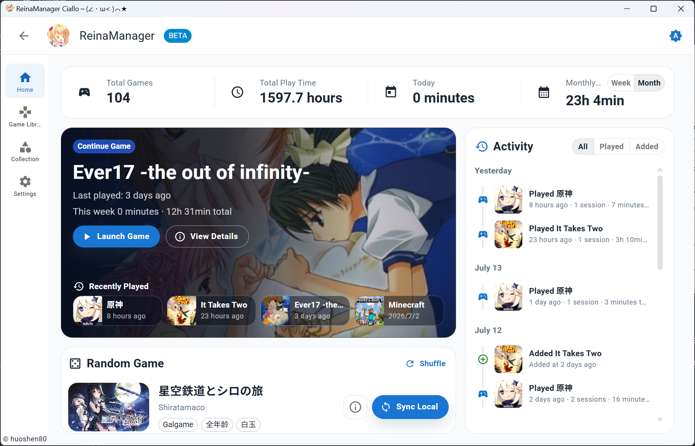
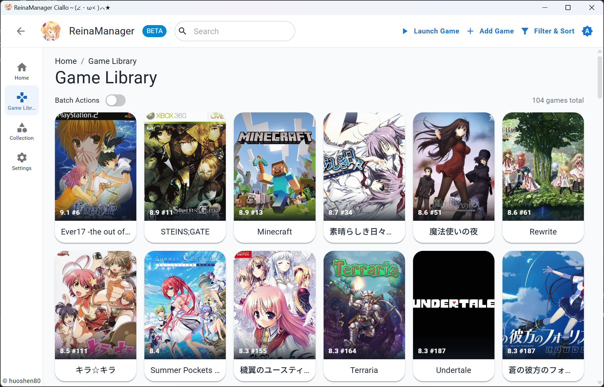
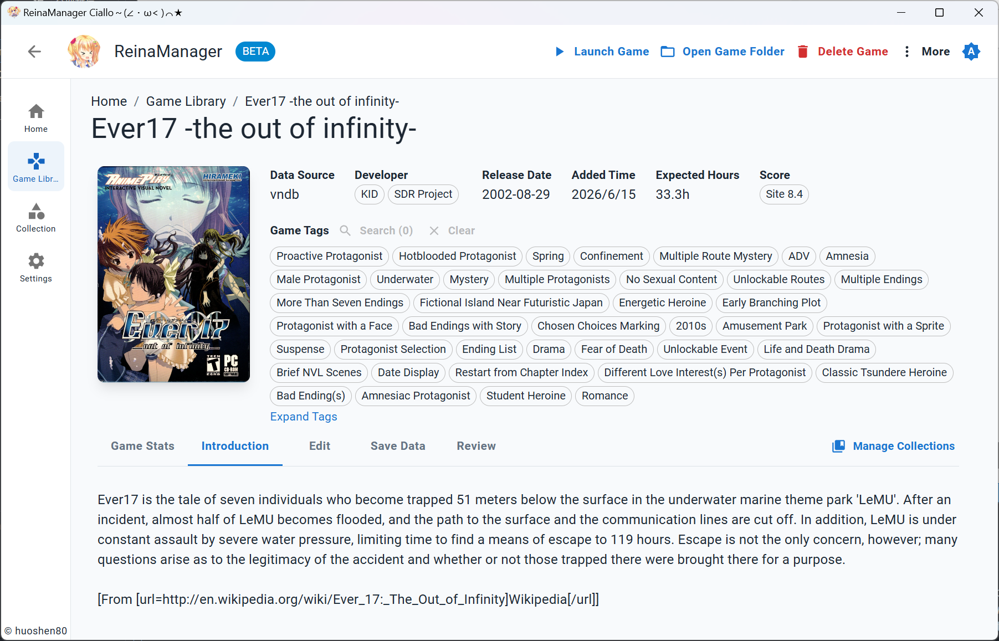
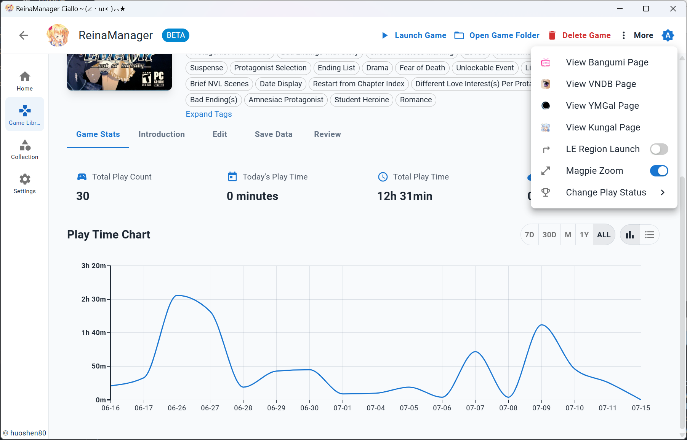
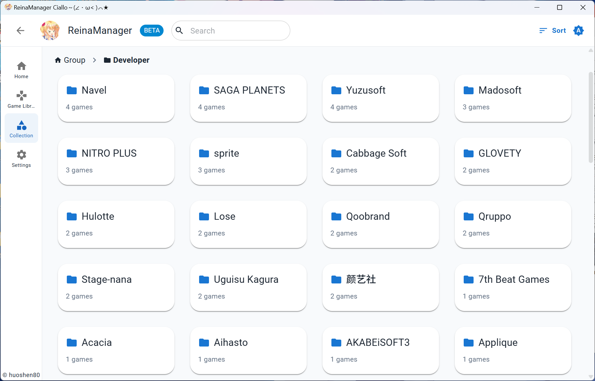

<div align="center">
  <div style="width:200px">
    <a href="https://vndb.org/c64303">
      
    </a>
  </div>

<h1>ReinaManager</h1>

    

[](https://qm.qq.com/q/lnCUkVjTpu) [](https://wakatime.com/badge/user/36a51c62-bf3b-4b81-9993-0e5b0e7ed309/project/efb3bd00-20c2-40de-98b6-e2f4a24bc120)

开发时间统计自 v0.9.0 版本起

<p align="center"><a href="./README.md">English</a>|中文|<a href="./README.zh_TW.md">繁體中文</a>|<a href="./README.ja_JP.md">日本語</a></p>

<h5>一个轻量级的 Galgame / 视觉小说管理工具，正在开发中...</h5>

名称中的 `Reina` 来源于游戏 <a href="https://vndb.org/v21852"><b>金色ラブリッチェ(Kin'iro Loveriche)</b></a> 中的角色 <a href="https://vndb.org/c64303"><b>妃 玲奈(Kisaki Reina)</b></a>

</div>

## 技术栈

- Tauri 2

- React

- Material UI

- UnoCSS

- Zustand

- TanStack Query

- Sqlite

- Rust

- SeaORM

## 功能特性

- 🌐 **多源数据整合** - 无缝获取合并展示多源 API 的游戏元数据
- 🔍 **强大的搜索** - 通过游戏标题、别名、自定义名称及其他信息快速搜索游戏
- 🗂️ **筛选排序** - 对游戏进行多维度的筛选和排序，如按来源、状态、标签等
- 📚 **收藏管理** - 通过分组和分类组织游戏库，并支持拖拽排序
- 🎮 **游戏时长追踪** - 自动记录游戏会话，提供详细的游玩时间统计和历史记录
- 🎨 **个性化定制** - 支持自定义游戏封面、名称、简介、标签等信息，打造专属游戏库
- 🔄 **批量操作** - 支持从 API 批量导入、添加和更新游戏元数据
- 🌍 **多语言支持** - 提供完整的国际化支持，包含简体中文、繁体中文、英文、日文等语言
- 🔒 **NSFW 过滤** - 通过简单的开关隐藏或遮盖 NSFW 内容
- 💾 **存档备份** - 支持手动和自动备份游戏存档
- 🛠️ **工具集成** - 启动游戏可联动 Locale Emulator 转区和 Magpie 放大
- 🔄 **云端收藏同步** - 支持从云端平台导入收藏，并同步游戏状态、评分和评价

## 截图








更多内容，你可以下载最新的发布版本：[下载](https://github.com/huoshen80/ReinaManager/releases)

## 从其他管理器迁移

[reina_migrator](https://github.com/huoshen80/reina_migrator) 可将其他管理器的游戏库、游玩记录等数据迁移到 ReinaManager，目前支持：

- **WhiteCloud v0.4.0**
- **Playnite 10**（需使用 [Reina Exporter](https://github.com/huoshen80/Reina-Playnite-Exporter) 插件）

## 开发与贡献

欢迎提交问题、建议和 Pull Request。开发前请阅读[项目文档](docs/README.md)，了解模块边界与开发约定。

### 本地运行

准备好 [Node.js](https://nodejs.org/)、[pnpm](https://pnpm.io/)、[Rust](https://www.rust-lang.org/) 以及对应平台的 Tauri 构建依赖。pnpm 版本以 `package.json` 的 `packageManager` 为准。

1. 克隆仓库：
   ```bash
   git clone https://github.com/huoshen80/ReinaManager.git
   cd ReinaManager
   ```
2. 安装依赖：
   ```bash
   pnpm install
   ```
3. 启动开发模式：
   ```bash
   pnpm tauri dev
   ```
4. 构建应用：
   ```bash
   pnpm tauri build
   ```


## 赞助
如果你觉得这个项目好用，并希望支持项目的开发，可以考虑赞助。非常感谢每个支持者！
- [Sponsor link](https://huoshen80.top/233.html)

## 感谢

- **[Bangumi](https://bangumi.tv/)** - Bangumi 番组计划

- **[VNDB](https://vndb.org/)** - 视觉小说数据库

- **[Ymgal](https://www.ymgal.games/)** - 月幕Galgame

- **[Kungal](https://www.kungal.com/)** - 鲲 Galgame

- **[Hikarinagi](https://www.hikarinagi.org/)** - 你和同好的ACGN社区

- **[Shionlib](https://shionlib.com/)** - 免费、开源、零门槛的 视觉小说/Galgame 档案库

特别感谢这些平台提供的公共 API 和数据以及资源！

- **[7-Zip](https://www.7-zip.org/)** - Windows 版内置其官方命令行工具，用于解压下载的游戏压缩包。

- **[7-Zip ZS (7-Zip-zstd)](https://github.com/mcmilk/7-Zip-zstd)** - 提供 Windows 版搭配 7-Zip 使用的 Zstd 插件，以及 Linux x64/arm64 版使用的命令行工具。

## 许可证

本项目采用 [AGPL-3.0 许可证](https://github.com/huoshen80/ReinaManager#AGPL-3.0-1-ov-file)

## Star 历史

<a href="https://www.star-history.com/?repos=huoshen80%2FReinaManager&type=date&legend=top-left">
 <picture>
   <source media="(prefers-color-scheme: dark)" srcset="https://api.star-history.com/chart?repos=huoshen80/ReinaManager&type=date&theme=dark&legend=top-left&sealed_token=8hJwvRzfF7BXsrTDsmX91vlKMmh-OU782v2ckuiCUm8XJc8v4vPWELSEqWkvVUZQhWnPygevDuNNJesLHwTVfm61OTlK0coF2jHWtmBIpC6kFrYHIVv6G5bHXVR0PkVEMtWasv4ybAZvIPPkGeSRZsopqmZoDStENlqvrCZxvxa4p3mkV99cA1ndh02b" />
   <source media="(prefers-color-scheme: light)" srcset="https://api.star-history.com/chart?repos=huoshen80/ReinaManager&type=date&legend=top-left&sealed_token=8hJwvRzfF7BXsrTDsmX91vlKMmh-OU782v2ckuiCUm8XJc8v4vPWELSEqWkvVUZQhWnPygevDuNNJesLHwTVfm61OTlK0coF2jHWtmBIpC6kFrYHIVv6G5bHXVR0PkVEMtWasv4ybAZvIPPkGeSRZsopqmZoDStENlqvrCZxvxa4p3mkV99cA1ndh02b" />
   
 </picture>
</a>
