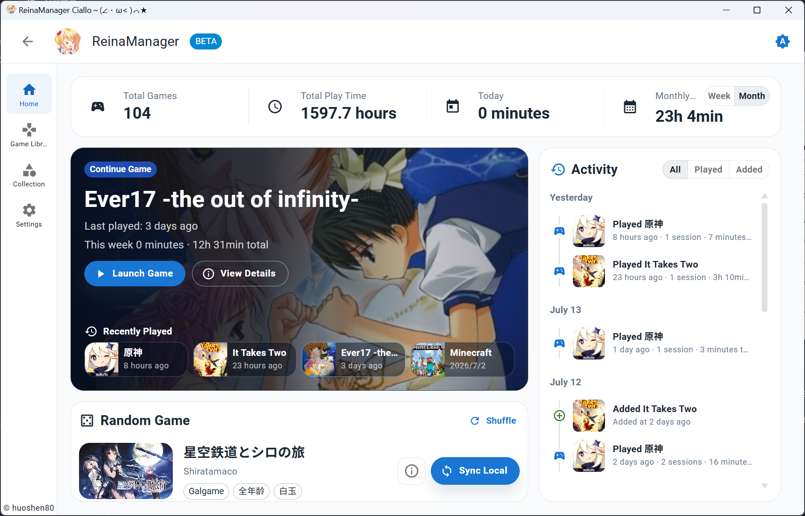
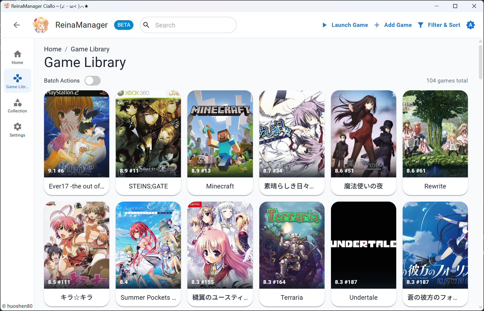
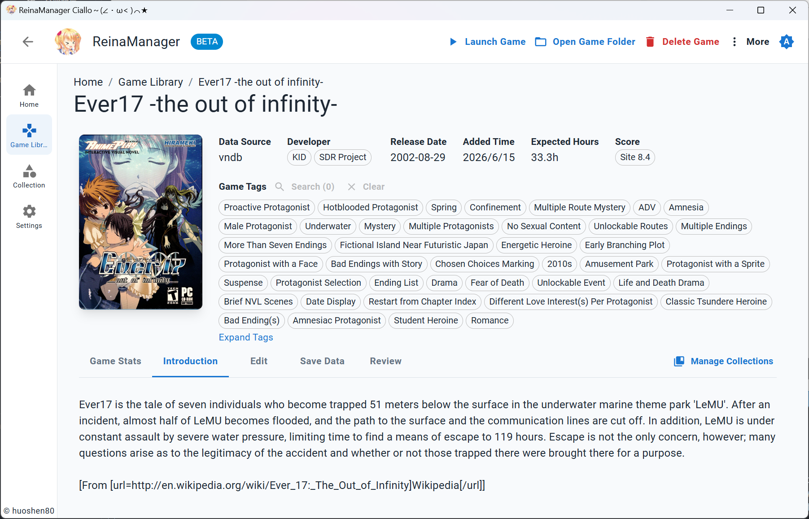
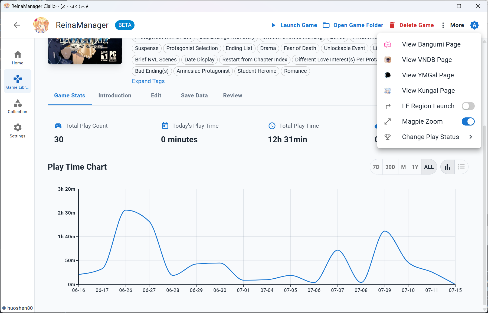
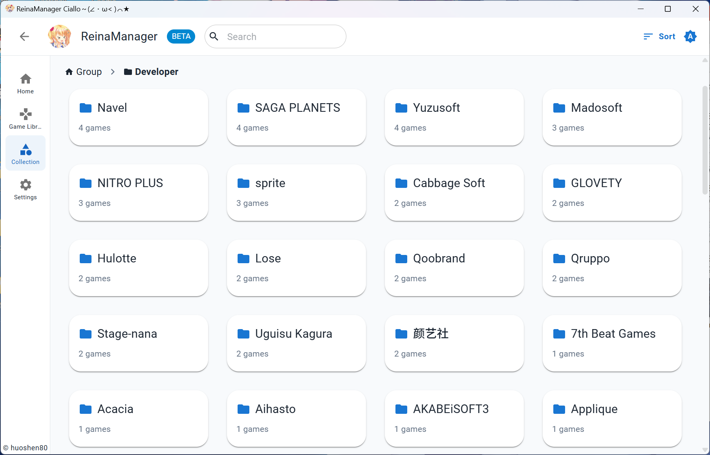

<div align="center">
  <div style="width:200px">
    <a href="https://vndb.org/c64303">
      
    </a>
  </div>

<h1>ReinaManager</h1>

    

[](https://qm.qq.com/q/lnCUkVjTpu) [](https://wakatime.com/badge/user/36a51c62-bf3b-4b81-9993-0e5b0e7ed309/project/efb3bd00-20c2-40de-98b6-e2f4a24bc120)

開發時間統計自 v0.9.0 版本起

<p align="center"><a href="./README.md">English</a>|<a href="./README.zh_CN.md">中文</a>|繁體中文|<a href="./README.ja_JP.md">日本語</a></p>

<h5>一個輕量級的 Galgame / 視覺小說管理工具，正在開發中...</h5>

名稱中的 `Reina` 來源於遊戲 <a href="https://vndb.org/v21852"><b>金色ラブリッチェ(Kin'iro Loveriche)</b></a> 中的角色 <a href="https://vndb.org/c64303"><b>妃 玲奈(Kisaki Reina)</b></a>

</div>

## 技術棧

- Tauri 2

- React

- Material UI

- UnoCSS

- Zustand

- TanStack Query

- Sqlite

- Rust

- SeaORM

## 功能特性

- 🌐 **多源數據整合** - 無縫獲取、合併並展示多個來源 API 的遊戲元數據
- 🔍 **強大的搜尋** - 透過遊戲標題、別名、自訂名稱及其他資訊快速搜尋遊戲
- 🗂️ **篩選排序** - 對遊戲進行多維度的篩選和排序，如按來源、狀態、標籤等
- 📚 **收藏管理** - 透過分組和分類組織遊戲庫，並支援拖曳排序
- 🎮 **遊戲時長追蹤** - 自動記錄遊戲會話，提供詳細的遊玩時間統計和歷史記錄
- 🎨 **個性化定制** - 支援自訂遊戲封面、名稱、簡介、標籤等資訊，打造專屬遊戲庫
- 🔄 **批量操作** - 支援從 API 批量匯入、添加和更新遊戲元數據
- 🌍 **多語言支持** - 提供完整的國際化支持，包含簡體中文、繁體中文、英文、日文等語言
- 🔒 **NSFW 過濾** - 通過簡單的開關隱藏或遮蓋 NSFW 內容
- 💾 **存檔備份** - 支援手動和自動備份遊戲存檔
- 🛠️ **工具整合** - 啟動遊戲可聯動 Locale Emulator 轉區和 Magpie 放大
- 🔄 **雲端收藏同步** - 支援從雲端平台匯入收藏，並同步遊戲狀態、評分和評價

## 截圖








更多資訊，您可以下載最新的發布版本：[下載](https://github.com/huoshen80/ReinaManager/releases)

## 從其他管理器遷移

[reina_migrator](https://github.com/huoshen80/reina_migrator) 可將其他管理器的遊戲庫、遊玩記錄等資料遷移到 ReinaManager，目前支援：

- **WhiteCloud v0.4.0**
- **Playnite 10**（需使用 [Reina Exporter](https://github.com/huoshen80/Reina-Playnite-Exporter) 外掛）

## 開發與貢獻

歡迎提交問題、建議和 Pull Request。開發前請閱讀[專案文件](docs/README.md)，了解模組邊界與開發慣例。

### 本機執行

準備好 [Node.js](https://nodejs.org/)、[pnpm](https://pnpm.io/)、[Rust](https://www.rust-lang.org/) 以及對應平台的 Tauri 建構相依套件。pnpm 版本以 `package.json` 的 `packageManager` 為準。

1. 複製儲存庫：
   ```bash
   git clone https://github.com/huoshen80/ReinaManager.git
   cd ReinaManager
   ```
2. 安裝相依套件：
   ```bash
   pnpm install
   ```
3. 啟動開發模式：
   ```bash
   pnpm tauri dev
   ```
4. 建構應用程式：
   ```bash
   pnpm tauri build
   ```

## 贊助
如果你覺得這個專案好用，並希望支持項目的開發，可以考慮贊助。非常感謝每個支持者！
- [Sponsor link](https://huoshen80.top/233.html)

## 感謝

- **[Bangumi](https://bangumi.tv/)** - Bangumi 番組計劃

- **[VNDB](https://vndb.org/)** - 視覺小說數據庫

- **[Ymgal](https://www.ymgal.games/)** - 月幕Galgame

- **[Kungal](https://www.kungal.com/)** - 鯤 Galgame

- **[Hikarinagi](https://www.hikarinagi.org/)** - 你和同好的 ACGN 社區

- **[Shionlib](https://shionlib.com/)** - 免費、開源、零門檻的視覺小說/Galgame 檔案庫

特別感謝這些平台提供的公共 API、數據與資源！

- **[7-Zip](https://www.7-zip.org/)** - Windows 版內建其官方命令列工具，用於解壓縮下載的遊戲壓縮檔。

- **[7-Zip ZS (7-Zip-zstd)](https://github.com/mcmilk/7-Zip-zstd)** - 提供 Windows 版搭配 7-Zip 使用的 Zstd 外掛，以及 Linux x64/arm64 版使用的命令列工具。

## 許可證

本專案採用 [AGPL-3.0 許可證](https://github.com/huoshen80/ReinaManager#AGPL-3.0-1-ov-file)

## Star 歷史

<a href="https://www.star-history.com/?repos=huoshen80%2FReinaManager&type=date&legend=top-left">
 <picture>
   <source media="(prefers-color-scheme: dark)" srcset="https://api.star-history.com/chart?repos=huoshen80/ReinaManager&type=date&theme=dark&legend=top-left&sealed_token=8hJwvRzfF7BXsrTDsmX91vlKMmh-OU782v2ckuiCUm8XJc8v4vPWELSEqWkvVUZQhWnPygevDuNNJesLHwTVfm61OTlK0coF2jHWtmBIpC6kFrYHIVv6G5bHXVR0PkVEMtWasv4ybAZvIPPkGeSRZsopqmZoDStENlqvrCZxvxa4p3mkV99cA1ndh02b" />
   <source media="(prefers-color-scheme: light)" srcset="https://api.star-history.com/chart?repos=huoshen80/ReinaManager&type=date&legend=top-left&sealed_token=8hJwvRzfF7BXsrTDsmX91vlKMmh-OU782v2ckuiCUm8XJc8v4vPWELSEqWkvVUZQhWnPygevDuNNJesLHwTVfm61OTlK0coF2jHWtmBIpC6kFrYHIVv6G5bHXVR0PkVEMtWasv4ybAZvIPPkGeSRZsopqmZoDStENlqvrCZxvxa4p3mkV99cA1ndh02b" />
   
 </picture>
</a>
