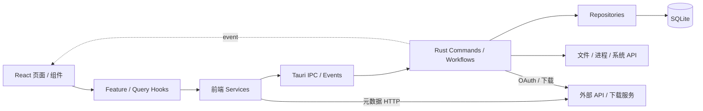

# 架构总览

ReinaManager 是由 React 前端与 Rust 后端组成的桌面应用。`spike/linux-cef` 实验分支使用 Tauri 3 alpha，Linux 采用 CEF，Windows 采用 Wry/WebView2；正式发行仍由主分支维护。

## 系统边界



React 负责界面、用例编排、查询缓存和元数据整合；Rust 负责本地持久化、文件系统、游戏进程、安装、备份、OAuth 和桌面集成。SQLite 保存核心业务数据，TanStack Query 缓存查询结果，Zustand 保存 UI 状态和偏好。

本地请求经 `src/services/invoke` 进入 Tauri commands；安装进度、游戏会话和授权结果通过 event 回传。元数据请求经前端 Tauri HTTP 插件发出，OAuth 与安装下载由 Rust 发起。图片协议提供本地封面和远程图片代理，`reinamanager://` 接收安装请求。

图中 repository 是常规数据库入口；安装、备份、OAuth 和游戏启动工作流也会直接访问 SeaORM entity。

## 目录地图

```text
src/
├── pages/              路由页面与页面私有逻辑
├── components/         跨页面 UI 组件
├── hooks/queries/      Query key、query、mutation、缓存策略
├── hooks/features/     用例级编排
├── services/invoke/    Tauri IPC 边界
├── services/           文件、运行时、认证、云端等工作流
├── metadata/           外部元数据源适配与合并
├── store/              Zustand 客户端状态
└── providers/          Router、Query、i18n 和主题

src-tauri/
├── src/                Tauri/Rust 应用代码
├── migration/          SeaORM 顺序迁移 crate
├── reina-path/         运行环境与标准/便携模式路径
├── reina-download/     可暂停、恢复的下载引擎
└── capabilities/       Tauri 权限声明
```

## 启动边界

后端入口 [`src-tauri/src/lib.rs`](../../src-tauri/src/lib.rs) 在访问数据前固定运行环境，并组装插件与 commands；[`lifecycle.rs`](../../src-tauri/src/lifecycle.rs) 负责启动和退出编排，完成数据库迁移后恢复持久化任务，再创建主窗口加载前端。数据库连接或 schema 迁移失败时，通过原生提示告知用户，确认后退出；旧版封面迁移失败只提示并记录日志，允许继续启动。开发与正式环境的数据隔离由 `reina-path` 统一管理。

前端入口 [`src/main.tsx`](../../src/main.tsx) 在挂载前完成首屏所需的状态和资源路径初始化；托盘、游戏会话监听和自动备份由应用级逻辑初始化，不依赖具体页面。

## 继续阅读

- React 分层和状态边界：[`frontend.md`](frontend.md)
- Rust 模块和存储：[`backend.md`](backend.md)
- 游戏库缓存与索引：[`game-library.md`](game-library.md)
- 外部元数据适配：[`metadata.md`](metadata.md)
